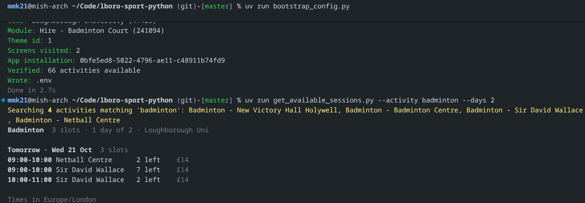
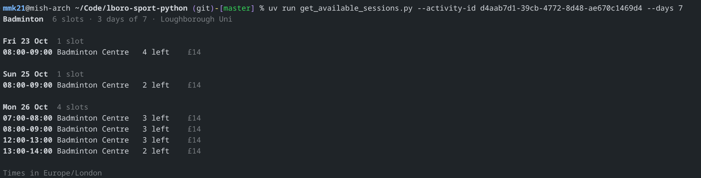

# `lboro-sport-python`

An unofficial Python API Client for the Loughborough Sport (Legend Online Services // myFitApp) service, modelled on the [official Android app](https://www.lboro.ac.uk/sport/app/)'s behaviour.

(Low-key forgot that there also exists a web app which would've been way easier to reverse engineer. Oh well.)




## Usage

### Quick start

Requires `uv` and Python 3.13 or newer.

```bash
# Fetch client configuration by pretending to be an Android app (required)
uv run bootstrap_config.py
# Fetch some badminton sessions using get_available_sessions.py
uv run get_available_sessions.py --activity badminton --days 7
```

### Command-line usage

View all available options for the session fetcher script:

```bash
uv run get_available_sessions.py --help
```

```none
Usage: get_available_sessions.py [OPTIONS]

  Find available facility-hire slots (for example badminton courts).

Options:
  -a, --activity <str>     Activity name or identifier to search for.
                           [default: badminton]
  -d, --date <str>         First day to search (YYYY-MM-DD). Defaults to
                           today.
  -n, --days <int range>   Number of days to search.  [default: 5; x>=1]
  --activity-id <str>      Skip activity lookup and use this identifier.
  --site-id <str>          Only search this location identifier.
  --site <str>             Only search locations whose name contains this
                           text.
  --include-full           Include slots with no spaces left.
  --page-size <int range>  API page size.  [default: 100; 1<=x<=500]
  -w, --wide               Show the site and slot ID under each slot.
  --json                   Print machine-readable JSON.
  --list-activities        List activities and locations, then exit.
  --user                   Sign in with LBORO_USERNAME/LBORO_PASSWORD instead
                           of using the public token.
  --help                   Show this message and exit.
```

### Use in Python code

The Python API client is contained within [client.py](src/lboro_sport_python/client.py). See [cli.py](src/lboro_sport_python/cli.py) for example usage.

The Python client is not currently exported as a library, but I'm sure you can figure it out if you want to make something. (Automated session booking script? Availability notifier? The possibilities are endless!)

### Useful identifiers

- Activity ID for badminton at the Badminton Centre: `d4aab7d1-39cb-4772-8d48-ae670c1469d4`

### Tests and linting

You can tell that I didn't code this project because it actually has tests.

```bash
uv run pytest
uv run ruff check .
```

## Credits

Heavily vibecoded by Mish using Command Code and DeepSeek V4.1. Sorry not sorry. As such, licensed under CC0 - do what you like as long as you don't me responsible.

README written by me.

## Disclaimer

This software provides an interface to certain [Legend Online Services](https://www.legendware.co.uk/) and [myFitApp](https://www.myfitapp.com/) APIs, but is not affiliated, endorsed, or supported by those software providers, or Loughborough University. I suggest using the official app/website to verify that the data it provides is accurate.

As per the CC0 license, this software is provided as-is and any usage is at your own risk.
